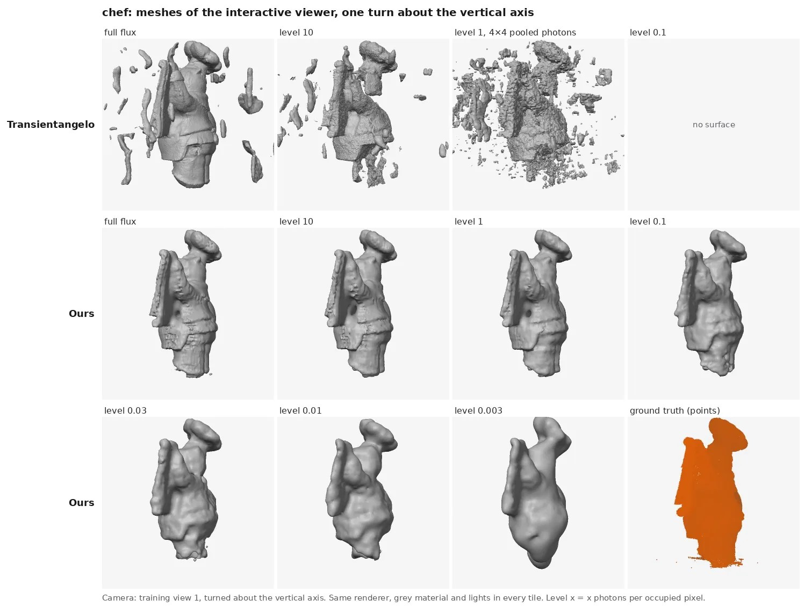

# FirstCross: Convex Single-Photon 3D Reconstruction from Sparse Views

[Project Page](https://arthur031221.github.io/firstcross/) | [arXiv](https://arxiv.org/abs/2611.26321) | [Paper](https://arthur031221.github.io/firstcross/paper.pdf)



FirstCross takes the photon histograms of a few single-photon lidar views and returns a surface field on a voxel grid, together with depth maps of any test camera.
For a solid object, the Poisson likelihood of a ray depends on the scene only through its first crossing, the point where the ray first enters the object.
Splitting this likelihood gives convex terms, one of which is volume rendering with a running-maximum transmittance in place of the product transmittance of NeRF.
The method therefore solves a short sequence of convex problems and uses no neural network.

## Installation

Tested on Linux with Python 3.11, PyTorch 2.5.1 with CUDA 12.4 and PyTorch 2.11. The paper timings use one NVIDIA RTX 4090.

```
git clone https://github.com/Arthur031221/firstcross.git
cd firstcross
conda create -n firstcross python=3.11
conda activate firstcross
pip install torch --index-url https://download.pytorch.org/whl/cu124
pip install -e .
```

The CPU tests of the core math run with `pip install -e ".[test]"` and `pytest`.

## Data

All paths below are relative to the repository root. The configs read `data/transientangelo` and `data/sp_transientbench`, and `--data_root` points them elsewhere.

### Transientangelo captured scenes

The object scenes come from the official [Transientangelo dataset](https://huggingface.co/datasets/weihan1/transientangelo_dataset) on Hugging Face (Luo, Malik and Lindell, WACV 2025).
The script below downloads the cameras, masks, pulse, intrinsics, the full-flux captures and the official low-flux levels 300, 150, 50 and 10 of each scene, about 4 GB per scene.
It takes the four test scenes by default, and the validation scenes on request.

```
bash scripts/download_transientangelo.sh
bash scripts/download_transientangelo.sh cinema carving
```

```
data/transientangelo/
├── intrinsics_safe.npz
├── pulse_low_flux.mat
├── masks/<scene>/train_NNN_mask.png
├── references/<scene>.npz              reference depths, written by evaluate.py
└── <scene>/                            baskets, boots, chef, food, cinema, carving
    ├── transientNNN.pt                 full flux
    ├── final_cams/{two,three,five}_views/transforms_train.json
    ├── final_cams/test_jsons/transforms_test.json
    └── {300,150,50,10}/transient_NN.pt official low-flux levels
```

Levels below 10 photons per pixel (PPP), namely 1, 0.1, 0.03, 0.01 and 0.003, are thinned from level 10 when a scene is loaded, with the seed rule used for the paper. They need no extra files.

### SP-TransientBench rooms

The rooms come from SP-TransientBench (Dong et al., SP-TransientBench: A Real-Captured Single Photon Perception Benchmark, ECCV 2026, [arXiv:2606.18952](https://arxiv.org/abs/2606.18952)).
Obtain the rooms c4floor2, material_building, physics_building3 and library_floor2 and the sensor calibration files from the authors' release.
Place each room folder and the calibration files as below.

```
data/sp_transientbench/
├── cfg/                                intrinsics_safe.npz, offset.txt, IRF_global.csv
├── <room>/                             sp_pose_results.csv, json/{three,five}_views/{train,test}.json,
│                                       RawDataHistogramMap_*.txt
└── hist/
    └── <room>/raw_NN.npy               full flux, written by prepare_rooms.py
```

Convert the histogram text files of each room to arrays.

```
for room in c4floor2 material_building physics_building3 library_floor2
do
    python scripts/prepare_rooms.py --src data/sp_transientbench/$room --out data/sp_transientbench/hist/$room
done
```

## Quick start

Reconstruct chef from three views at 0.1 PPP and score it on the ten test views.

```
python reconstruct.py --config configs/objects.yaml --scene chef --ppp 0.1 --views three --out output/chef_0.1_3v
python evaluate.py --config configs/objects.yaml --scene chef --field output/chef_0.1_3v_field.npz
```

`reconstruct.py` prints the number of detected returns, the rounds and the solve time. It writes the field on the grid to `output/chef_0.1_3v_field.npz` and the run settings to `output/chef_0.1_3v.json`.
`evaluate.py` prints the depth MAE and the object depth MAE in millimetres. It writes `output/chef_0.1_3v_metrics.json` with per-view errors and `output/chef_0.1_3v_depths.npz` with the rendered depth maps.
The first evaluation of a scene computes the reference depths from the full-flux test views and caches them in `data/transientangelo/references/`.

`--ppp` takes `full`, an official level (300, 150, 50, 10) or a lower level (1, 0.1, 0.03, 0.01, 0.003). `--views` takes `two`, `three` or `five`.

## Reproducing the paper

Each script runs the rows of one table below with three input views and writes the results to `output/`.

```
bash scripts/eval_objects.sh
bash scripts/eval_rooms.sh
```

Objects, depth error in mm (main table at 0.1 PPP, photon curve at 0.003 PPP, full flux). The object MAE sets the error to zero beyond 0.30 m from the scene origin, which removes the back wall of baskets and food.

| Scene | PPP | Depth MAE, paper | Object MAE, paper | Depth MAE, release | Object MAE, release |
|---|---|---|---|---|---|
| baskets | 0.1 | 5.644 | 1.495 | 5.656 | 1.510 |
| boots | 0.1 | 0.576 | 0.575 | 0.571 | 0.570 |
| chef | 0.1 | 1.757 | 1.757 | 1.793 | 1.793 |
| food | 0.1 | 5.018 | 0.870 | 5.044 | 0.895 |
| mean of four | 0.1 | 3.25 | 1.17 | 3.27 | 1.19 |
| chef | 0.003 | 2.636 | 2.635 | 2.636 | 2.635 |
| chef | full | 0.909 | 0.91 | 0.922 | 0.92 |

Rooms, depth MAE in m at 1% flux (room table).

| Room | Paper | Release |
|---|---|---|
| c4floor2 | 0.525 | 0.543 |
| material_building | 0.325 | 0.325 |
| physics_building3 | 1.193 | 1.227 |

On one NVIDIA RTX 4090, an object run takes about 1 min and a room run about 3 min, with no training.
The release columns come from this code on an NVIDIA Quadro RTX 8000 with PyTorch 2.5.1. GPU reductions are not bit-exact, so reruns on other cards can differ by a few percent.

The object inputs below level 10 are thinned with the same seeds as in the paper.
The room inputs at 1% flux are thinned from the full-flux histograms with the seed 1000 n + (int(10^6 p) mod 997) for view n and keep probability p (`thin_histogram` in `firstcross/data_rooms.py`).
This seed differs from the one behind the paper's room column, so the room release column is the reference for this code.

GPU runs are not bit-reproducible, because the solver accumulates sums with atomic adds whose order changes from run to run.
In our runs, the depth error of chef at 1 PPP varied by about 2.5% between repeated runs.

## Citation

```
@article{lee2026firstcross,
  title={FirstCross: Convex Single-Photon 3D Reconstruction from Sparse Views},
  author={Chi-Wei Lee and Cheng-Han Chiang and Yi-Chun Chang and An-Kai Chen and Po-Chih Kuo},
  journal={arXiv preprint arXiv:2611.26321},
  year={2026}
}
```

## Acknowledgements

The object captures, cameras, masks, laser pulse and intrinsics come from the [Transientangelo](https://github.com/weihan1/transientangelo) release by Weihan Luo, Anagh Malik and David B. Lindell.
The rooms come from SP-TransientBench by Hongzhou Dong and colleagues.
The paper compares with Transientangelo and [TransientNeRF](https://github.com/anaghmalik/TransientNeRF) through their official code.

## License

The code is released under the MIT license, see [LICENSE](LICENSE). The datasets keep their own licenses.
